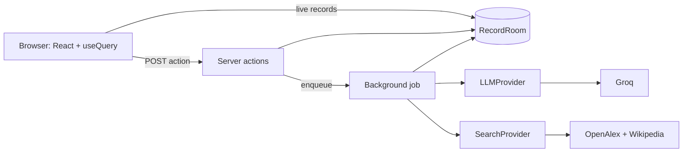

# ScoutRoom

A shared, live research room: a server-side AI agent finds evidence, your team votes on it, and a cited brief is written from what you kept.

**Live:** https://scoutroom.app.space

## What it does

1. **Rooms and roles.** Create a room with a research question. Invite people with links as `researcher` or `viewer` (the creator is `owner`).
2. **Live agent run.** An owner or researcher clicks *Run scout*. The agent plans searches, searches, and writes evidence cards. Everyone in the room watches the steps and cards appear live.
3. **Team votes.** Each member votes keep or reject on each card. Counts update live for everyone.
4. **Cited brief.** *Write brief* summarises **only the kept cards**, with `[n]` citations that jump to the card.

## Try it in 2 minutes

1. Open the live link in one browser and sign in. Open it in a private window with a second account.
2. In browser A: create a room and ask a question.
3. Copy the invite link and open it in browser B.
4. In A: click **Run scout**. Watch both windows fill with steps and cards.
5. Vote keep or reject on cards in both windows.
6. In A: click **Write brief** (disabled until a card is kept). Check that the `[n]` links jump to the right card.

## DeepSpace pieces used

| Need | DeepSpace primitive | How we use it |
|---|---|---|
| Sign-in | Auth | Server actions get a verified `userId`. |
| Who can do what | RBAC, `read: 'team'` | Room data is readable only by room members. Writes go through role-checked actions. |
| Data + live updates | Records, `useQuery` | Rooms, runs, steps, cards, votes and briefs are records. The board updates without refresh. |
| Who is online | `usePresenceRoom` | Shows who is in the room. |
| Safe server logic | Server actions | `startRun`, `castVote`, `generateBrief`, invites and roles. |
| Long work | Background jobs | `startRun` enqueues the agent run. Clients cannot enqueue. |
| No double runs or votes | `uniqueOn` | One lock per room, one vote per person per card, one `seq` per brief. |
| Secrets | `npx deepspace secrets` | Holds the Groq key. Never in code or the browser. |
| Hosting | `npx deepspace deploy` | Runs at `scoutroom.app.space`. |
| Debugging | `npx deepspace logs` | Worker logs for runs. |

## Architecture



Details: [docs/design/05-architecture.md](docs/design/05-architecture.md).

## Main tradeoff

My DeepSpace account has 0 credits, so the DeepSpace `anthropic`, `exa` and `scholar` integrations were not usable. The agent talks to two small interfaces, `LLMProvider` and `SearchProvider`. Today they use **Groq** (free tier, my own key), **OpenAlex** (papers) and **Wikipedia** (background). Switching to DeepSpace is a config change (`LLM_PROVIDER` / `SEARCH_PROVIDER` in `wrangler.toml`), with no agent change. The price: Wikipedia is a weak web source, so cards are mostly background and papers. See [docs/design/08-integrations.md](docs/design/08-integrations.md).

Left out on purpose: payments (no paying user), `fal` images (decoration), `email` + `cron` (watch mode, later), `google/*` export (needs per-user OAuth).

## Safety

- AI and search calls run **only on the server**.
- Roles are checked **on the server**; the UI hiding a button is not the protection.
- Budget guard: per-room run limit (5) and a hard cap of 8 tool calls per run.
- One run per room at a time (a `uniqueOn` lock).
- Model output must be strict JSON; cards and briefs are validated, and a citation must point to a real source or card.
- Prompt-injection guard: search text is marked as untrusted data, the agent has no tools, and only our code saves records.
- Secrets live only in `npx deepspace secrets`. A pre-commit check (`scripts/check-secrets.sh`) blocks secret-like content.

Details: [docs/design/09-security-and-privacy.md](docs/design/09-security-and-privacy.md).

## Reliability

I reviewed what happens when a run goes wrong and found 6 issues: [docs/design/13-reliability.md](docs/design/13-reliability.md).

- **#1 and #2 fixed:** runs write a heartbeat (`lastProgressAt`); a stale run is failed and its lock freed by a lazy reaper inside `startRun`. Check with `npm run check:reliability`.
- **#3 to #6 are future work**, each with suggested options: no transaction in `startRun`, half-saved cards, a retry setting that never fires, failed runs using up the quota.

## Tests and logs

- Unit tests (vitest) and two-user Playwright tests. Automated tests use **fake providers**, so they make no Groq or OpenAlex calls.
- `npx deepspace test run all` runs everything. `npm run test:unit` runs unit tests only. `npm run validate` runs the type check and unit tests.
- `npx deepspace logs` shows worker logs.
- Each run's `run_steps` records are its timeline (plan, search, cards) and are shown live in the room.

## How I worked with the agent

Design docs, then a spike, then one feature per session, each on its own branch with a PR. An independent review session checked PR #1. I test, merge and deploy myself, from `main` only.

- Session log: [docs/agent-log.md](docs/agent-log.md)
- Prompts: [docs/prompts/](docs/prompts/)
- Tokens: [docs/token-usage.md](docs/token-usage.md). Sessions 00 to 07 cost about $10.6 API-equivalent (I use a subscription), and 95% of tokens were cache reads.

## Known gaps and what's next

- A brief sentence can add a little outside detail that is not in its card (seen in a real Groq run). Citations are checked, wording is not.
- A person in about 100 or more rooms breaks live reads (SQLite variable limit). There is no leave or delete room yet.
- Reliability issues #3 to #6 above.
- Later, in order: switch to DeepSpace providers, challenge-a-card, usage dashboard, room templates, live brief editing, watch mode, agent tools, Google Docs export. See [docs/design/12-roadmap.md](docs/design/12-roadmap.md).

## Run locally

```bash
npm install
npx deepspace auth login
npx deepspace dev start
npx deepspace test run all
```

Set the Groq key from a pipe so it is never typed or shown (`--stdin` reads the value):

```bash
pbpaste | npx deepspace secrets set GROQ_API_KEY --stdin
```

Design docs, the source of truth: [docs/design/](docs/design/00-README.md).
