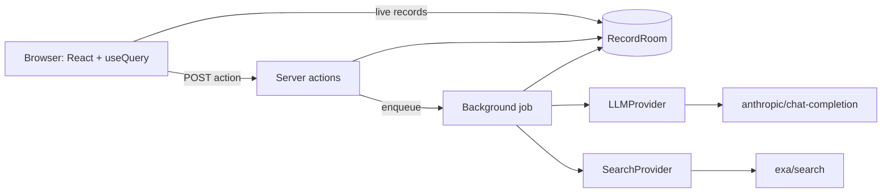

# ScoutRoom

A shared, live research room: a server-side AI agent finds evidence, your team votes on it, and a cited brief is written from what you kept.

**Live:** https://scoutroom.app.space

## What it does

1. **Rooms and roles.** Create a room with a research question. Invite people with links as `researcher` or `viewer` (the creator is `owner`).
2. **Live agent run.** An owner or researcher clicks *Run scout*. The agent plans searches, searches, and writes evidence cards. Everyone in the room watches the steps and cards appear live.
3. **Team votes.** Each member votes keep or reject on each card. Counts update live for everyone.
4. **Cited brief.** *Write brief* summarises **only the kept cards**, with `[n]` citations that jump to the card.

## Try it in 2 minutes

1. Open the live link in one browser and sign in. Open it in a private window with a second account.
2. In browser A: create a room and ask a question.
3. Copy the invite link and open it in browser B.
4. In A: click **Run scout**. Watch both windows fill with steps and cards.
5. Vote keep or reject on cards in both windows.
6. In A: click **Write brief** (disabled until a card is kept). Check that the `[n]` links jump to the right card.

## DeepSpace pieces used

| Need | DeepSpace primitive | How we use it |
|---|---|---|
| Sign-in | Auth | Server actions get a verified `userId`. |
| Who can do what | RBAC, `read: 'team'` | Room data is readable only by room members. Writes go through role-checked actions. |
| Data + live updates | Records, `useQuery` | Rooms, runs, steps, cards, votes and briefs are records. The board updates without refresh. |
| Who is online | `usePresenceRoom` | Shows who is in the room. |
| Safe server logic | Server actions | `startRun`, `castVote`, `generateBrief`, invites and roles. |
| Long work | Background jobs | `startRun` enqueues the agent run. Clients cannot enqueue. |
| No double runs or votes | `uniqueOn` | One lock per room, one vote per person per card, one `seq` per brief. |
| AI and search | Integrations (`tools.integration`) | The job calls `anthropic/chat-completion` and `exa/search` from the server, paid from the owner's credits. No key in the app. |
| Secrets | `npx deepspace secrets` | Only for the optional free fallback (a Groq key). Never in code or the browser. |
| Hosting | `npx deepspace deploy` | Runs at `scoutroom.app.space`. |
| Debugging | `npx deepspace logs` | Worker logs for runs. |

## Architecture



The providers are chosen by two settings (`LLM_PROVIDER`, `SEARCH_PROVIDER`). The free fallback (Groq, OpenAlex, Wikipedia) is the other branch of the same two interfaces.

Details: [docs/design/05-architecture.md](docs/design/05-architecture.md).

## DeepSpace integrations used

AI and search run on the server through DeepSpace integrations, paid from the app owner's DeepSpace credits (100 credits = $1). The agent talks to two small interfaces, `LLMProvider` and `SearchProvider`; the adapters live in `src/providers/deepspace.ts`.

| Integration | What it does here | Rough cost |
|---|---|---|
| `anthropic/chat-completion` (`claude-haiku-5-5`) | Plans the searches, writes the evidence cards, writes the brief. Strict JSON, checked with zod. | A run uses 2 calls, a brief 1. Together under 0.2 credits. |
| `exa/search` | Web background (general search) and research papers (`category: "research paper"`). A run makes 3 searches. | About 0.9 credit per search, so **about 3 credits per run**. |
| `scholar/search-papers` | Google Scholar papers. **Built and contract-tested but not in use:** DeepSpace's Scholar provider returned "Your account has run out of searches" (502, billing released) during the build, so it is not the default. Switch with `SEARCH_PROVIDER = "deepspace-scholar"` once it works again. | $0.0325 per call, one call per run. |

Two integrations are in use and one is built and ready. A run is about 3 credits and a brief is a fraction of a credit, so 500 credits cover well over 100 runs. Exa results are saved as `background` cards (confidence capped at 60%) or `paper` cards; there is no separate "web" badge. Details and the setting values: [docs/design/08-integrations.md](docs/design/08-integrations.md). If the owner runs out of credits, the run or brief fails with "Out of DeepSpace credits" and nothing falls back silently.

## Free fallback providers

The same two interfaces also have a free option that does not use DeepSpace integrations: **Groq** (`openai/gpt-oss-20b`, the owner's own key) for the AI, and **OpenAlex** (papers) plus **Wikipedia** (background) for search. They are external providers, kept for when credits run out. To switch, set in `wrangler.toml`:

```toml
LLM_PROVIDER = "groq"
SEARCH_PROVIDER = "free"
```

and store the key once (`pbpaste | npx deepspace secrets set GROQ_API_KEY --stdin`). The two settings are independent.

Left out on purpose: payments (no paying user), `fal` images (decoration), `email` + `cron` (watch mode, later), `google/*` export (needs per-user OAuth).

## Safety

- AI and search calls run **only on the server**.
- Roles are checked **on the server**; the UI hiding a button is not the protection.
- Budget guard: per-room run limit (5) and a hard cap of 8 tool calls per run.
- One run per room at a time (a `uniqueOn` lock).
- Model output must be strict JSON; cards and briefs are validated, and a citation must point to a real source or card.
- Prompt-injection guard: search text is marked as untrusted data, the agent has no tools, and only our code saves records.
- Secrets live only in `npx deepspace secrets`. A pre-commit check (`scripts/check-secrets.sh`) blocks secret-like content.

Details: [docs/design/09-security-and-privacy.md](docs/design/09-security-and-privacy.md).

## Reliability

I reviewed what happens when a run goes wrong and found 6 issues: [docs/design/13-reliability.md](docs/design/13-reliability.md).

- **#1 and #2 fixed:** runs write a heartbeat (`lastProgressAt`); a stale run is failed and its lock freed by a lazy reaper inside `startRun`. Check with `npm run check:reliability`.
- **#3 to #6 are future work**, each with suggested options: no transaction in `startRun`, half-saved cards, a retry setting that never fires, failed runs using up the quota.

## Tests and logs

- Unit tests (vitest) and two-user Playwright tests. Automated tests use **fake providers**, so they make no real AI or search calls and cost nothing. Adapter contract tests use recorded sample responses (no network). One manual spec (`SCOUTROOM_REAL=1 npx deepspace test run e2e --grep "real integrations"`) runs one real scout run and one real brief for about 3 credits.
- `npx deepspace test run all` runs everything. `npm run test:unit` runs unit tests only. `npm run validate` runs the type check and unit tests.
- `npx deepspace logs` shows worker logs.
- Each run's `run_steps` records are its timeline (plan, search, cards) and are shown live in the room.

## How I worked with the agent

Design docs, then a spike, then one feature per session, each on its own branch with a PR. An independent review session checked PR #1. I test, merge and deploy myself, from `main` only.

- Session log: [docs/agent-log.md](docs/agent-log.md)
- Prompts: [docs/prompts/](docs/prompts/)
- Tokens: [docs/token-usage.md](docs/token-usage.md). Sessions 00 to 07 cost about $10.6 API-equivalent (I use a subscription), and 95% of tokens were cache reads.

## Known gaps and what's next

- A brief sentence can add a little outside detail that is not in its card (seen in a real run). Citations are checked, wording is not.
- A person in about 100 or more rooms breaks live reads (SQLite variable limit). There is no leave or delete room yet.
- Reliability issues #3 to #6 above.
- Scholar is not in use until DeepSpace's Scholar provider works again (see above).
- Later, in order: challenge-a-card, usage dashboard, room templates, live brief editing, watch mode, agent tools, Google Docs export. See [docs/design/12-roadmap.md](docs/design/12-roadmap.md).

## Run locally

```bash
npm install
npx deepspace auth login
npx deepspace dev start
npx deepspace test run all
```

Local dev uses the providers in `wrangler.toml` (DeepSpace integrations), so a real run spends a few credits. Check with `npx deepspace app usage`.

Design docs, the source of truth: [docs/design/](docs/design/00-README.md).
