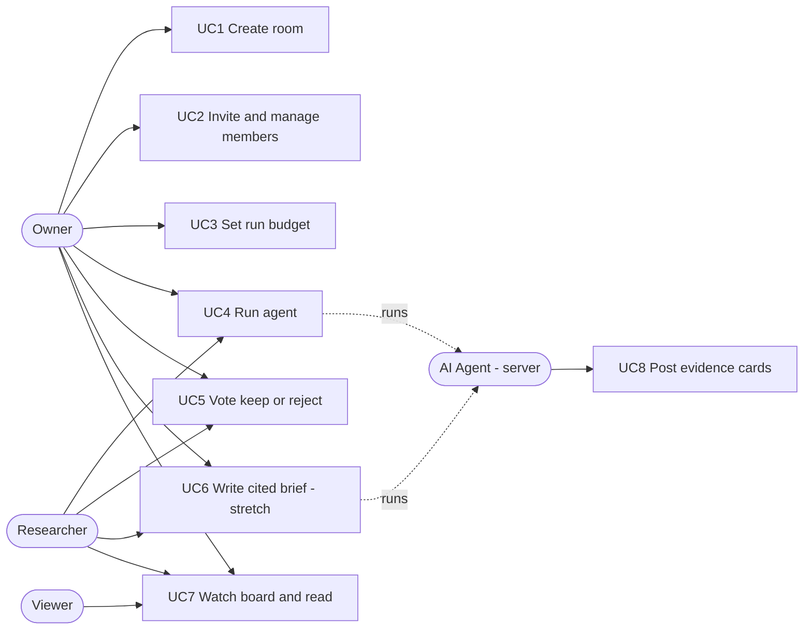

# 02 · Use Cases

> **In simple words:** This page lists who can do what in ScoutRoom, step by step, and what can go wrong. There are four actors: Owner, Researcher, Viewer, and the AI Agent (a system actor on the server).

## Use case diagram

## [THIS BUILD] use cases

### UC1 · Create a room (F1)
- **Actor:** any signed-in user (becomes Owner).
- **Steps:** click "New room" -> enter title + question -> save.
- **What can go wrong:** empty question (blocked, shows a message). Not signed in (sent to sign-in).

### UC2 · Invite and manage members (F1)
- **Actor:** Owner.
- **Steps:** open Members -> create an invite link for a role (researcher or viewer) -> share it -> person opens it, signs in, joins with that role. Owner can change a role or remove a member.
- **What can go wrong:** expired or revoked link (clear error). Owner tries to remove themselves (blocked: a room always has one owner).

### UC3 · Set the budget (F2)
- **Actor:** Owner.
- **Steps:** open Settings -> set "max runs for this room".
- **What can go wrong:** value below 0 or too large (validated on the server).

### UC4 · Run the agent (F2)
- **Actor:** Owner or Researcher.
- **Steps:** click "Run agent" -> the run appears as `queued` -> `running` -> steps appear live -> cards appear live -> `done`.
- **What can go wrong:**
  - A viewer tries (server refuses).
  - A run is already active (refused: "a run is in progress").
  - Run limit reached (refused).
  - Search or AI call fails (run ends `failed`, steps so far are kept).
  - User clicks Stop (run ends `stopped`).
  - User closes the page (the run keeps going on the server).

### UC5 · Vote (F3)
- **Actor:** Owner or Researcher.
- **Steps:** click Keep or Reject on a card -> counts update live for everyone. Clicking again changes your vote.
- **What can go wrong:** viewer tries (refused). Double click (still one vote per person per card).

### UC6 · Cited brief (F4, stretch)
- **Actor:** Owner or Researcher. The AI Agent writes it.
- **Steps:** click "Write brief" -> agent uses **only kept cards** -> brief appears with [1] [2] links to cards.
- **What can go wrong:** no kept cards (button disabled). The brief cites a number that is not a kept card (validation rejects it).

### UC7 · Watch and read (F1/F2)
- **Actor:** everyone in the room, including Viewer.
- **Steps:** open the room -> see steps, cards, counts, who is online.
- **What can go wrong:** not a member (sees "no access", gets no data).

### UC8 · Post evidence cards (F2)
- **Actor:** AI Agent (server).
- **Steps:** after searching, return strict JSON -> validate -> save cards.
- **What can go wrong:** invalid JSON (see [07-agent-run-design.md](07-agent-run-design.md)).

## [FUTURE] use cases

- Challenge a card: ask the agent to dig deeper on one card.
- Watch mode: daily re-check and an email digest of changes.
- My own coding agent queries a room through agent tools.
- Export the brief to Google Docs.
- Co-edit the brief live.
- Start a room from a template.
- See usage and cost per room.
