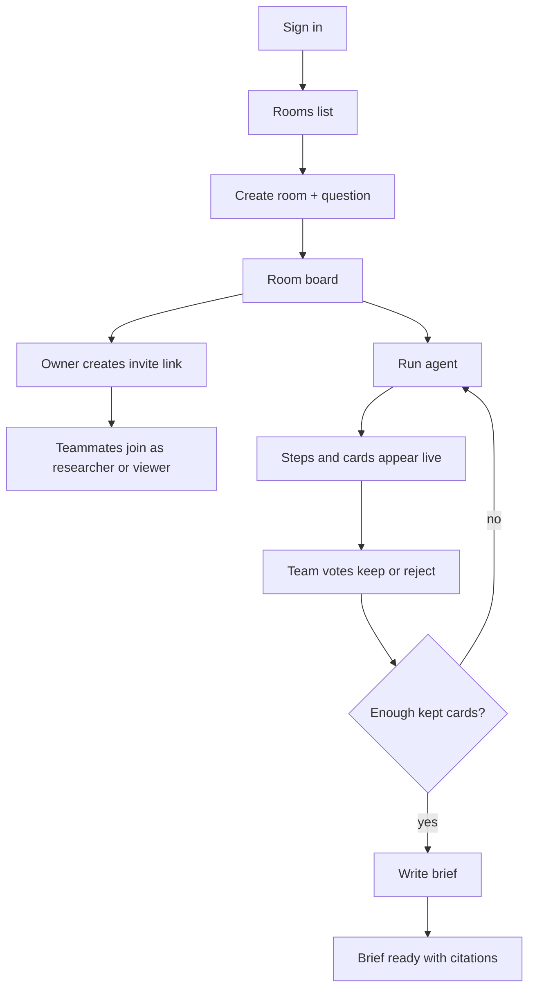

# 04 · Screens and User Flow

> **In simple words:** This page shows how the app looks and how a person moves through it, from sign-in to "brief ready". The pictures are rough boxes, not final design.

## Screens

| Screen | Who | Tag |
|---|---|---|
| Sign in | everyone | [THIS BUILD] (scaffold already has auth) |
| Rooms list | signed-in | [THIS BUILD] |
| Create room | signed-in | [THIS BUILD] |
| Room board (main) | members | [THIS BUILD] |
| Run panel (part of the board) | members | [THIS BUILD] |
| Card detail | members | [THIS BUILD] |
| Brief (a section above the cards on the room page) | members read; owner/researcher write | [THIS BUILD] (built) |
| Members / settings | owner (members: read) | [THIS BUILD] |

## Wireframes

### Rooms list
```
+--------------------------------------------------+
| ScoutRoom                          [ + New room ] |
+--------------------------------------------------+
| Which vector DB in 2026?     owner    3 online    |
| Competitor scan: Acme        viewer   0 online    |
+--------------------------------------------------+
```

### Create room
```
+------------------------------------+
| New room                           |
| Title    [______________________]  |
| Question [______________________]  |
|          [______________________]  |
|              [Cancel] [Create]     |
+------------------------------------+
```

### Room board (main screen)
```
+-------------------------------------------------------------+
| Which vector DB in 2026?        online: Sam, Priya   [Brief] |
+----------------------+--------------------------------------+
| RUN PANEL            | EVIDENCE BOARD                       |
| Status: running      | +----------------+ +---------------+ |
| Runs left: 3 of 5    | | Claim...       | | Claim...      | |
| [Run agent] [Stop]   | | exa - web      | | scholar-paper | |
|                      | | conf: high     | | conf: medium  | |
| Steps:               | | Keep 2 Rej 0   | | Keep 0 Rej 1  | |
|  1 Plan        done  | | [Keep] [Reject]| | [Keep][Reject]| |
|  2 Search 1/4  done  | +----------------+ +---------------+ |
|  3 Search 2/4  ...   |                                      |
+----------------------+--------------------------------------+
```

### Card detail
```
+--------------------------------------------+
| Claim: "Qdrant supports hybrid search..."  |
| Source: example.com/post   (web)  [Open]   |
| Confidence: high    Found in run #2        |
| Quote: "..."                               |
| Votes: Keep 2 (Sam, Priya)  Reject 0       |
|              [Keep]  [Reject]              |
+--------------------------------------------+
```

### Brief
```
+------------------------------------------------------------+
| Brief   [Write a new brief]   2 / 5 briefs used            |
| (Stale) Votes changed since this brief: regenerate?        |
| We recommend X because it supports hybrid search [1].      |
| Y is cheaper at small scale [2] [3].                       |
| [1] Qdrant supports hybrid... -> source link               |
| Brief 2 · written from 3 kept cards by deepspace/<model>    |
+------------------------------------------------------------+
```
- Each `[n]` is a button. Clicking it clears the card filter, scrolls to that card on the board and highlights it for a few seconds.
- "Stale" shows when the cards that are kept **now** differ from the kept set the brief was written from (compared as sets, so order does not matter).
- The button is off, with the hint "Keep at least one card first.", while 0 cards are kept; off with a "Brief limit reached" badge at 5 / 5. Viewers see the brief and the counter, not the button.
- States: loading ("Loading brief..."), empty ("No brief yet"), writing ("The AI is writing the brief..."), error (red message under the button, e.g. "rate limited, try again"), limit reached.
- A new brief appears for everyone in the room live (live query on `briefs`).

### Members / settings
```
+--------------------------------------------+
| Members                  [Create invite]   |
| Sam (owner)                                |
| Priya  [researcher v]  [Remove]            |
| Lee    [viewer v]      [Remove]            |
| Budget: max runs [ 5 ]        [Save]       |
+--------------------------------------------+
```

## User flow: sign-in to "brief ready"



## States of the room board

| State | What the user sees |
|---|---|
| **Loading** | Skeleton cards and a "Connecting..." line while the live connection opens. |
| **Empty** (no run yet) | "No evidence yet. Run the agent to start." Run button for owner/researcher. Viewers see "Waiting for the team to run the agent." |
| **Running** | Run panel shows steps as they finish. Cards appear one by one. Stop button. |
| **Error: run failed** | Red banner with the reason in plain words and the steps that did finish. "Run again" if runs are left. |
| **Error: no access** | "You are not a member of this room." No data is loaded. |
| **Error: connection lost** | Small banner "Reconnecting..." The live connection reconnects by itself (DeepSpace does this). Data shown stays visible. |
| **Budget reached** | Run button disabled with "Run limit reached. Ask the owner." |
