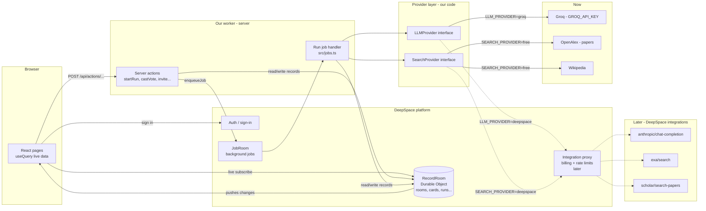

# 05 · Architecture

> **In simple words:** The browser shows React pages. DeepSpace gives us login, storage, live updates and permissions. Our own server code (a Cloudflare worker) runs the agent and calls AI and search through DeepSpace's integration proxy. Nothing secret ever reaches the browser.

## Component diagram



A **server action** is a function on our server that the browser calls with the user's login token. It runs "as the app", so it can do things the user cannot do directly. A **background job** is work that keeps running after the web request ends.

## Which DeepSpace service does what

| Need | DeepSpace piece | How we use it | Source (doc page) |
|---|---|---|---|
| Login / sign-up | Auth (built in; JWT verified on server) | Scaffold already has it. Actions get a verified `userId`. | `/guides/server-actions` (ActionContext); `worker.ts` (`resolveAuth`) |
| Who-can-do-what | RBAC + `team_members` | `read: 'team'` for room data; role checks in actions for writes. | `/concepts/permissions` |
| Storing data | Collections in one `RecordRoom` Durable Object (scope `app:<APP_ID>`) | Rooms, members, runs, steps, cards, votes, brief are records. | `/concepts/data-model#scopes`; `src/constants.ts` (`SCOPE_ID`) |
| Live updates | `useQuery` subscriptions (DO pushes `record_change`) | Board, steps, counts update without refresh. | `/concepts/realtime-sync#what-the-do-sends` |
| Who's online | `usePresence` (60 s heartbeat) or `usePresenceRoom` | Show who is in the room. Per-room presence: T8. | `/guides/presence-and-cursors` |
| Running the agent | Server action (`startRun`) + background job (`JobRoom`) | Action validates and enqueues; job runs steps. | `/guides/server-actions`; `/guides/background-jobs` |
| Calling AI and search | **Now:** our own provider layer (`LLMProvider`, `SearchProvider`) calling Groq, OpenAlex and Wikipedia with plain server-side `fetch`. **Later:** DeepSpace integration proxy (`anthropic/chat-completion`, `exa/search`, `scholar/search-papers`) | Chosen by `LLM_PROVIDER` and `SEARCH_PROVIDER`. DeepSpace credits are 0 today, so the proxy is the later option. See [08](08-integrations.md). | `/guides/external-apis`; `npx deepspace integrations info <name>` |
| Secrets | `npx deepspace secrets` store | **One secret now: the owner's `GROQ_API_KEY`, plus `OPENALEX_MAILTO`.** Set with `npx deepspace secrets set`, read by the worker as an env binding, never in the browser or git. DeepSpace integrations need none. | `/concepts/deployment#secrets-come-from-the-store-not-from-dev-vars`; `/cli-reference/commands#secrets` |
| Hosting / deploy | `npx deepspace deploy` to `<app>.app.space` | One command. | `AGENTS.md`; `wrangler.toml` |
| Logs and usage | `npx deepspace logs`, `npx deepspace app usage` | Debug runs; watch spend. | `/cli-reference/commands#logs`; `/agents/website-maintenance-checklist-uptime-backups-ssl-updates` |
| Tests | `npx deepspace test run` | API + e2e tests. | `package.json` scripts |

## What the scaffold already has (read from this repo)

- `worker.ts` already wires `RecordRoom`, `JobRoom`, `PresenceRoom`, `CronRoom`, and `registerActionRoutes`. We **add** to it, we do not replace it.
- `src/schemas.ts` has only `users` and `settings`. We add our collections here.
- `src/actions/index.ts` is an empty actions map. `src/jobs.ts` is a no-op `runJob`.
- `src/integrations.ts` lists `google` and `composio` only. Others default to `developer` billing (owner pays, sign-in required).
- `src/ai/` (agent, tools, chat routes) is the scaffold's built-in AI chat. We do **not** use it in this build.

## Where the code will live

```
src/
  schemas/            rooms, team_members, invites, runs, run_steps, cards, votes, briefs, run_locks
  schemas.ts          add the new schemas to the list
  actions/index.ts    createRoom, createInvite, joinRoom, setRole, removeMember,
                      setBudget, startRun, stopRun, castVote, generateBrief
  jobs.ts             runJob: 'scout-run' (plan -> search -> cards)
  agent/              plan.ts, search.ts, cards.ts, validate.ts (zod), prompts.ts  (server only)
    providers/        types.ts (the two interfaces), index.ts (getProviders from env settings),
                      groq.ts, openalex.ts, wikipedia.ts            (now)
                      deepspace-anthropic.ts, deepspace-exa.ts, deepspace-scholar.ts   (later)
    pipeline.ts       Plan B: fixed pipeline inside one action (fallback, see 07)
  pages/(app)/(protected)/
                      rooms/index.tsx, rooms/[roomId].tsx (board), settings tabs
  components/room/    RunPanel, CardBoard, CardDetail, MemberList, BriefView
worker.ts             tighten AppJobRoom.authorizeWrite (see 03)
tests/                api + e2e specs
```

Rule: anything under `src/agent/` is imported only by worker code, never by pages.
