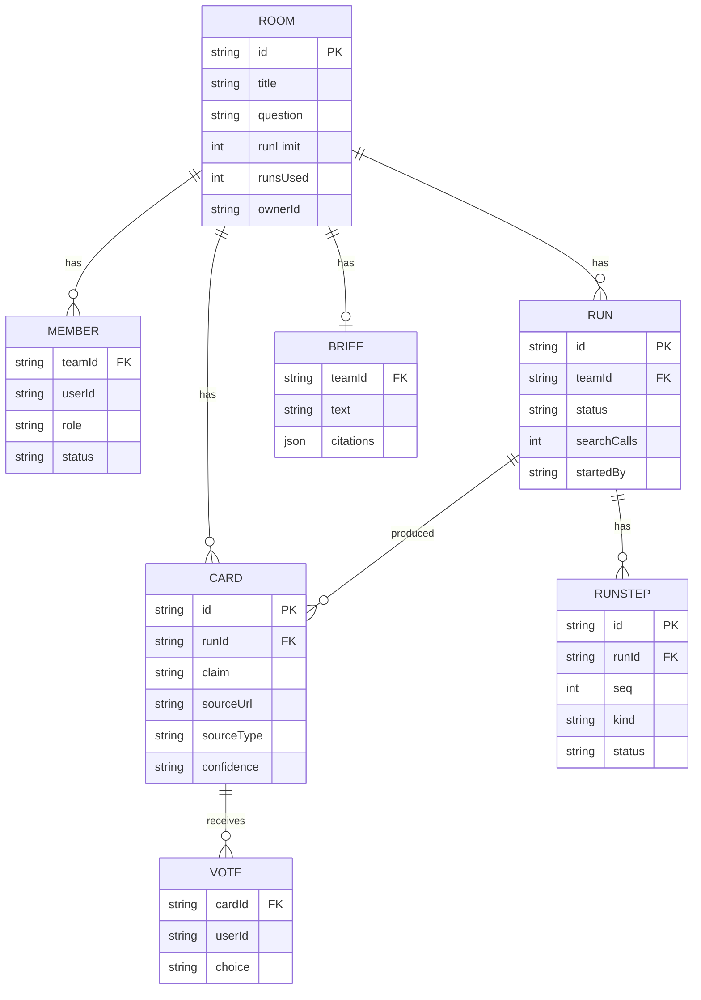

# 06 · Data Model

> **In simple words:** Everything is stored as records in collections (like tables) inside DeepSpace's `RecordRoom`. Each record belongs to one room through a `teamId` column. That one column lets DeepSpace show a room's data only to that room's members.

## Diagram



## Collections

Common to all: a `teamId` text column (the room id) and DeepSpace's built-in `createdBy`, `createdAt`, `updatedAt`.
Read rule for every room collection: members read `'team'`. Write rule: `create/update/delete: false` for `member`; **all writes go through server actions** (they bypass RBAC). Admin (app owner) reads all.
*Source: https://docs.deep.space/concepts/permissions*

### `rooms`
| Field | Type | Notes |
|---|---|---|
| title | text | required, max 120 |
| question | text | required, max 500 |
| teamId | text | equals this record's own id (so `'team'` can resolve). **T2** |
| ownerId | text | creator's user id |
| runLimit | number | owner sets; **default 5** (decided). One question per room; re-runs allowed while `runsUsed < runLimit`; each run adds cards |
| runsUsed | number | incremented by `startRun` |
| inviteVersion | number | bump to revoke all old links |

### `team_members` (name required by DeepSpace for `'team'` reads)
| Field | Type | Notes |
|---|---|---|
| teamId | text | room id |
| userId | text | `userBound` |
| role | select | `owner` / `researcher` / `viewer` (extra column, **T2**) |
| status | select | `active` / `removed` (a row counts as a member when `active` or empty) |

`uniqueOn: ['teamId','userId']`: one membership per person per room.

### `invites`
| Field | Type | Notes |
|---|---|---|
| teamId | text | room id |
| code | text | random, unguessable |
| role | select | `researcher` / `viewer` (never `owner`) |
| expiresAt | number | e.g. 7 days |
| revoked | boolean | |

Read: **owner only** (a custom server action returns the link; the code is never listed to other members).

### `runs`
| Field | Type | Notes |
|---|---|---|
| teamId | text | room id |
| status | select | `queued` / `running` / `done` / `failed` / `stopped` |
| stopRequested | boolean | set by `stopRun`, checked between steps |
| startedBy | text | user id |
| searchCalls | number | 0..8 (hard cap) |
| aiCalls | number | cap 3 (plan, cards, one repair) |
| error | text | plain-words reason when `failed` |
| jobId | text | the background job id (Plan A only) |
| plan | select | `job` (Plan A) / `action` (Plan B), see [07](07-agent-run-design.md) |
| llmProvider, searchProvider | text | names of the providers used, e.g. `groq`, `openalex+wikipedia` (audit and later cost review) |
| inputTokens, outputTokens | number | from the LLM response if available |

### `run_steps`
| Field | Type | Notes |
|---|---|---|
| teamId, runId | text | |
| seq | number | order, 1..n. `uniqueOn: ['runId','seq']` makes a retried step safe |
| kind | select | `plan` / `search_web` / `search_papers` / `cards` / `brief` |
| status | select | `running` / `done` / `failed` |
| summary | text | plain words, e.g. "Searched the web: 'qdrant hybrid search' (8 results)" |

### `cards`
| Field | Type | Notes |
|---|---|---|
| teamId, runId | text | |
| claim | text | 1..280 chars |
| sourceUrl | text | must come from this run's search results |
| sourceTitle | text | |
| sourceName | text | e.g. `OpenAlex`, `Wikipedia` (later `Exa`, `Scholar`) |
| sourceType | select | `web` / `paper` |
| confidence | select | `low` / `medium` / `high` |
| quote | text | optional, max 300 |
| keepCount, rejectCount | number | recomputed from `votes` after each vote |
| decision | select | `open` / `kept` / `rejected`. **Kept = keeps > rejects AND keeps >= 1.** Rejected = rejects > keeps. Else open (see 07) |

### `votes`
| Field | Type | Notes |
|---|---|---|
| teamId, cardId | text | |
| userId | text | `userBound`, `immutable` |
| choice | select | `keep` / `reject` |

`uniqueOn: ['cardId','userId']`: one vote per person per card; changing a vote updates the same row.

### `briefs` [THIS BUILD, stretch]
| Field | Type | Notes |
|---|---|---|
| teamId | text | one brief per room (`uniqueOn: ['teamId']`) |
| text | text | uses `[n]` markers |
| citations | json | `[{ n: 1, cardId }]`, only kept cards |
| generatedBy | text | user id |

### `run_locks` (the one-run-per-room lock)
| Field | Type | Notes |
|---|---|---|
| teamId | text | `uniqueOn: ['teamId']`. A second create is refused by DeepSpace. **T3** |
| runId | text | |
| expiresAt | number | stale-lock rescue if a job dies |

## Example records

```json
{
  "recordId": "card_8f3a",
  "data": {
    "teamId": "room_21c",
    "runId": "run_77b",
    "claim": "Qdrant supports hybrid dense+sparse search natively.",
    "sourceUrl": "https://example.com/qdrant-hybrid",
    "sourceTitle": "Hybrid search in Qdrant",
    "sourceType": "web",
    "confidence": "high",
    "quote": "Qdrant combines dense and sparse vectors in one query.",
    "keepCount": 2,
    "rejectCount": 0,
    "decision": "kept"
  }
}
```

## Who can read and write (summary)

| Collection | Read | Write |
|---|---|---|
| rooms, runs, run_steps, cards, votes, briefs | room members | server actions / job only |
| team_members | room members | server actions only |
| invites, run_locks | owner (invites) / nobody (locks) | server actions / job only |

The `users` collection and `useUsers()` already exist in the scaffold. Note: `useUsers()` shows id, name, image and role of **all** registered users to any signed-in member; see [09-security-and-privacy.md](09-security-and-privacy.md).
