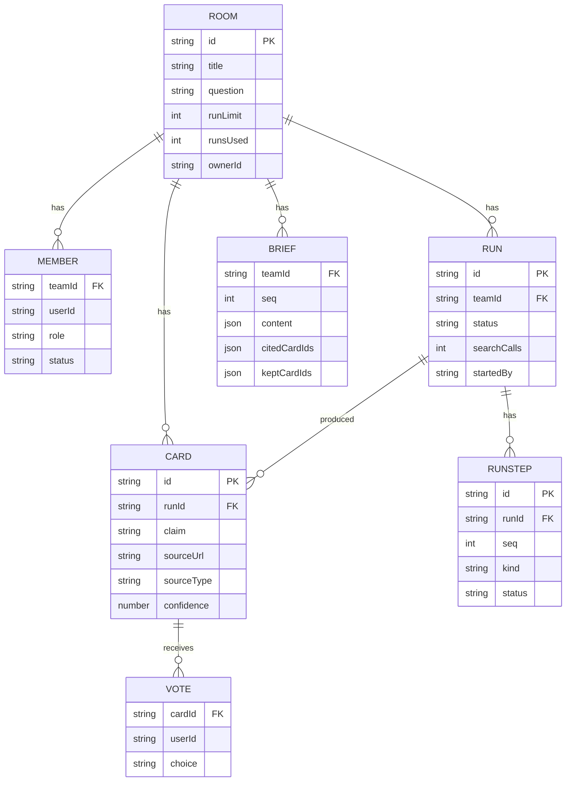

# 06 · Data Model

> **In simple words:** Everything is stored as records in collections (like tables) inside DeepSpace's `RecordRoom`. Each record belongs to one room through a `teamId` column. That one column lets DeepSpace show a room's data only to that room's members.

## Diagram



## Collections

Common to all: a `teamId` text column (the room id) and DeepSpace's built-in `createdBy`, `createdAt`, `updatedAt`.
Read rule for every room collection: members read `'team'`. Write rule: `create/update/delete: false` for `member`; **all writes go through server actions** (they bypass RBAC). Admin (app owner) reads all.
*Source: https://docs.deep.space/concepts/permissions*

### `rooms`
| Field | Type | Notes |
|---|---|---|
| title | text | required, max 120 |
| question | text | required, max 500 |
| teamId | text | equals this record's own id (so `'team'` can resolve). **T2** |
| ownerId | text | creator's user id |
| runLimit | number | owner sets; **default 5** (decided). One question per room; re-runs allowed while `runsUsed < runLimit`; each run adds cards |
| runsUsed | number | incremented by `startRun` |
| inviteVersion | number | bump to revoke all old links |

### `team_members` (name required by DeepSpace for `'team'` reads)
| Field | Type | Notes |
|---|---|---|
| teamId | text | room id |
| userId | text | `userBound` |
| role | select | `owner` / `researcher` / `viewer` (extra column, **T2**) |
| status | select | `active` / `removed` (a row counts as a member when `active` or empty) |

`uniqueOn: ['teamId','userId']`: one membership per person per room.

### `invites`
| Field | Type | Notes |
|---|---|---|
| teamId | text | room id |
| code | text | random, unguessable |
| role | select | `researcher` / `viewer` (never `owner`) |
| expiresAt | number | e.g. 7 days |
| revoked | boolean | |

Read: **owner only** (a custom server action returns the link; the code is never listed to other members).

### `runs`
| Field | Type | Notes |
|---|---|---|
| teamId | text | room id |
| question | text | copy of the room question at start time |
| status | select | `queued` / `running` / `done` / `failed` / `stopped` |
| toolCallsUsed | number | LLM and search calls together, hard cap 8 per run |
| error | text | plain-words reason when `failed` |
| startedBy | text | user id |
| lastProgressAt | number | heartbeat, ms since epoch. Set when the run is created, when a step begins and ends, and on every tool call. `startRun` uses it to tell a live run from a dead one (the stale rule in [07](07-agent-run-design.md#stuck-runs-the-stale-rule-and-the-reaper)). Optional: runs created before this field existed have none and are never judged stale |

`stopRun` sets `status = 'stopped'` directly (there is no separate `stopRequested` flag). The job reads the status at the start of every step, so a stop takes effect at the **next step boundary** (up to one model call later), saves no cards, and frees the lock. See [07](07-agent-run-design.md).

### `run_steps`
| Field | Type | Notes |
|---|---|---|
| teamId, runId | text | |
| seq | number | order, 1..4. `uniqueOn: ['runId','seq']` makes a retried step safe |
| label | text | `Planning` / `Searching papers` / `Checking background` / `Writing cards` |
| status | select | `running` / `done` / `failed` |
| detail | text | plain words, e.g. "2 paper queries + 1 background query" |

### `cards`
| Field | Type | Notes |
|---|---|---|
| teamId, runId | text | |
| claim | text | 1..280 chars |
| sourceUrl | text | must be one of the URLs this run's searches returned |
| sourceTitle | text | taken from our search hit, not from the model |
| sourceType | select | `paper` (OpenAlex) / `background` (Wikipedia). Taken from our search hit |
| confidence | number | 0 to 1. `background` cards are capped at 0.6 |

Votes are **not** stored on the card. The keep/reject counts and the Kept / Rejected / Undecided status are computed from `votes` (see [Card decision rule](07-agent-run-design.md#card-decision-rule-f3)), so they cannot drift.

### `votes`
| Field | Type | Notes |
|---|---|---|
| teamId | text | room id (the `'team'` read rule needs it) |
| cardId | text | |
| userId | text | the voter |
| value | select | `keep` / `reject` |

`uniqueOn: ['cardId','userId']`: one vote per person per card. Changing a vote replaces that row; removing a vote deletes it. Reads: room members. Client writes: denied; only the `castVote` server action writes (owner and researcher only). `removeMember` deletes the removed person's votes in that room (D12).

### `briefs` [THIS BUILD]
We **keep history** (every brief written, max 5 per room) and the page shows the latest. Why: the limit then counts saved rows, and a bad regenerate never destroys a good brief.

| Field | Type | Notes |
|---|---|---|
| teamId | text | room id |
| seq | number | 1, 2, 3... per room. `uniqueOn: ['teamId','seq']`: two briefs written at the same moment cannot take the same slot, so the limit of 5 cannot be passed |
| content | text | JSON `[{ text, citations: [cardId] }]`, already validated. `text` has no `[n]` markers; the page adds them |
| citedCardIds | text | JSON array of card ids in order of first appearance. Marker `[n]` = position `n` in this list |
| keptCardIds | text | JSON array (sorted) of the kept card ids **at generation time**. The page compares it with the kept set now to show "Stale" |
| createdBy | text | user id |
| model | text | `<provider>/<model>`, e.g. `groq/openai/gpt-oss-20b` |

Reads: room members. Client writes: denied; only the `generateBrief` action writes (owner and researcher only).

### `run_locks` (the one-run-per-room lock)
**Why it exists:** two people clicking Run at the same moment must not start two runs (double cost, tangled steps). `uniqueOn: ['teamId']` means DeepSpace refuses a second lock for the same room, so exactly one click wins. The lock is released when the run ends or is stopped.

| Field | Type | Notes |
|---|---|---|
| teamId | text | `uniqueOn: ['teamId']`. A second create is refused by DeepSpace. **T3** |
| runId | text | the run that holds the lock |
| expiresAt | number | 15-minute fallback, used only when the lock's run has ended or is missing. A live run's lock is judged by the run's `lastProgressAt`, not by this time (see [07](07-agent-run-design.md#stuck-runs-the-stale-rule-and-the-reaper)) |

Nobody reads it from the browser (read denied for every role).

## Example records

```json
{
  "recordId": "card_8f3a",
  "data": {
    "teamId": "room_21c",
    "runId": "run_77b",
    "claim": "Qdrant supports hybrid dense+sparse search natively.",
    "sourceUrl": "https://example.com/qdrant-hybrid",
    "sourceTitle": "Hybrid search in Qdrant",
    "sourceType": "paper",
    "confidence": 0.9
  }
}
```

## Who can read and write (summary)

| Collection | Read | Write |
|---|---|---|
| rooms, runs, run_steps, cards, votes, briefs | room members | server actions / job only |
| team_members | room members | server actions only |
| invites, run_locks | owner (invites) / nobody (locks) | server actions / job only |

The `users` collection and `useUsers()` already exist in the scaffold. Note: `useUsers()` shows id, name, image and role of **all** registered users to any signed-in member; see [09-security-and-privacy.md](09-security-and-privacy.md).
